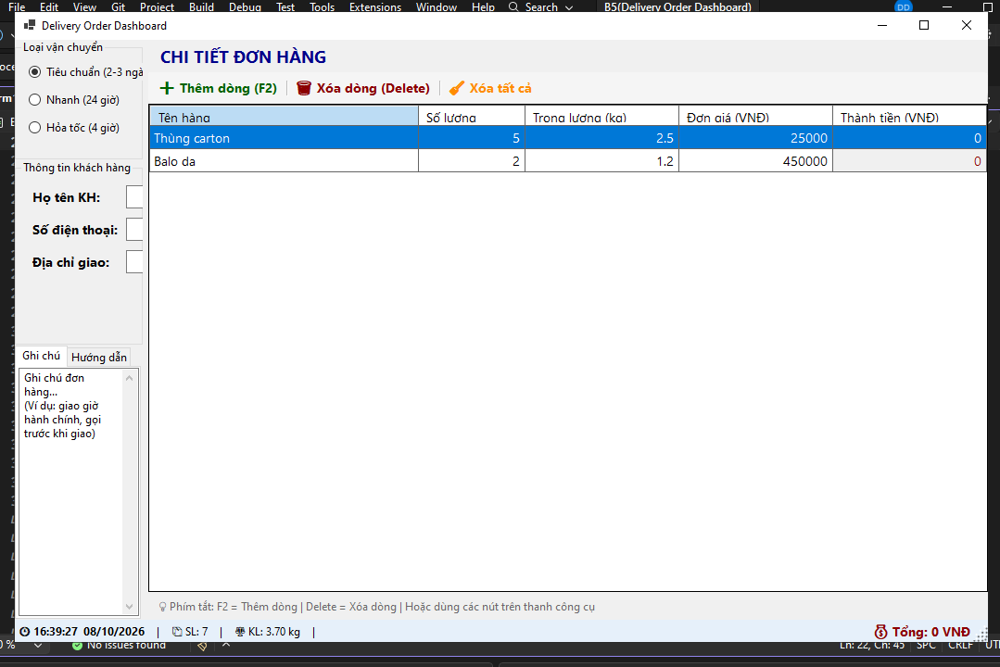
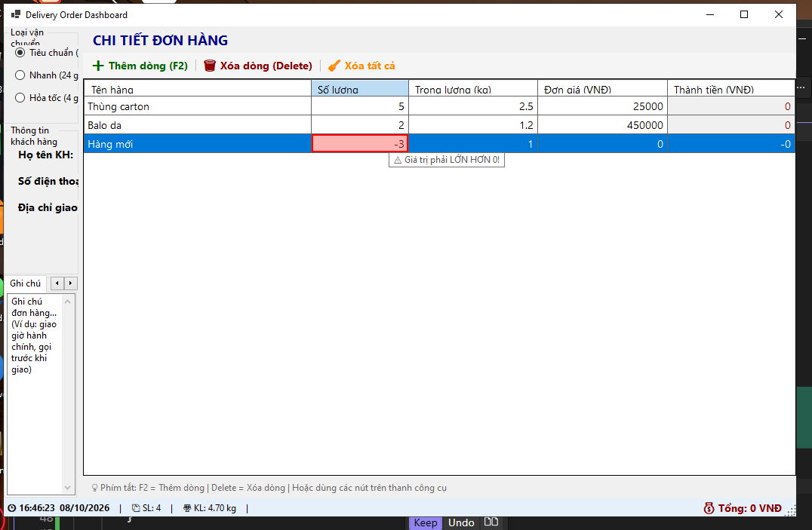
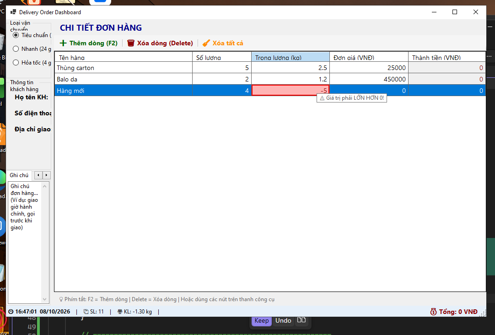
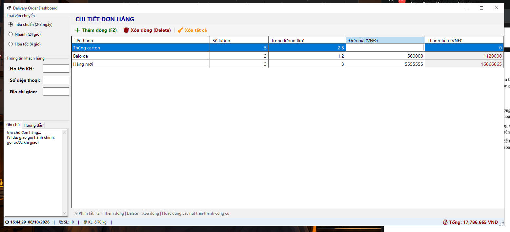
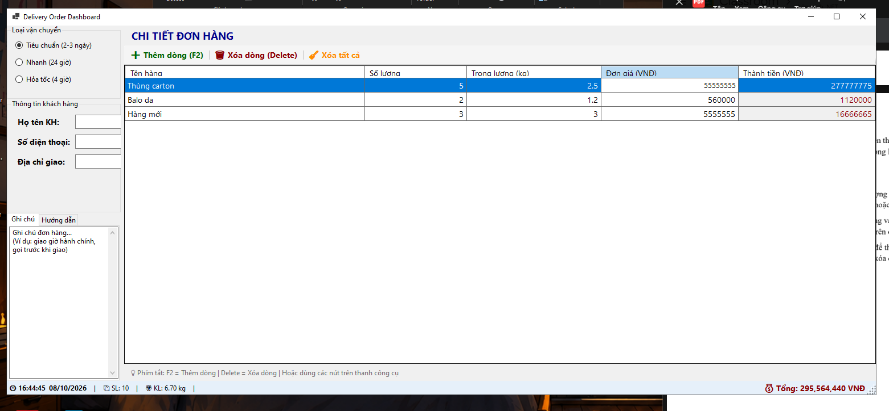
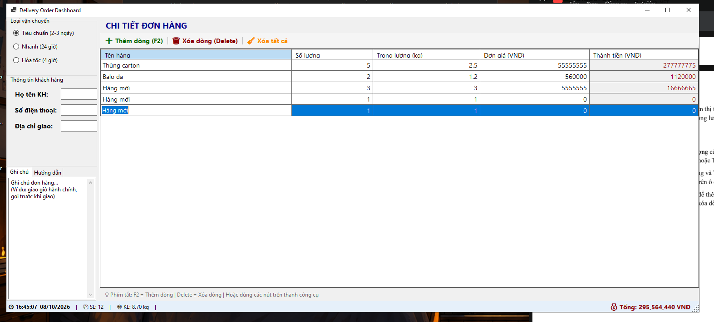
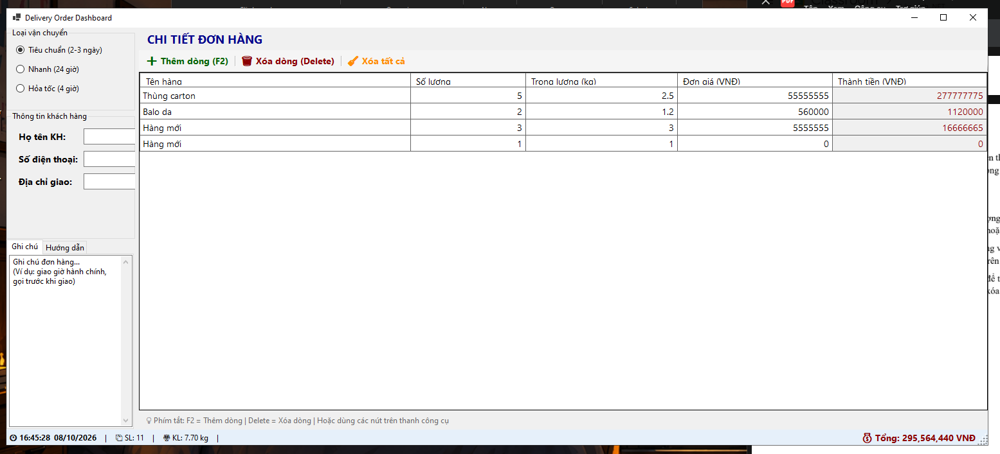

# BÁO CÁO BÀI TẬP

## THÔNG TIN SINH VIÊN
- **Họ và tên: Đặng Cao Thành Đạt**
- **Mã số sinh viên: 24810320215** 
- **Lớp: D19QTANM1** 
- **Tên môn học: Lập Trình.Net** 
- **Tên bài tập: Bài 5: Bảng điều khiển Quản lý Đơn giao hàng (Delivery Order Dashboard)** 

---

## KẾT QUẢ THỰC HÀNH

### 1. Ảnh màn hình Giao diện chính

### 2. Sử dụng ErrorProvider để bật biểu tượng cảnh báo đỏ ngay bên cạnh ô nhập nếu người dùng nhập Số lượng hoặc Trọng lượng ≤ 0.
### so luong

### trong luong

### 3. Tự động tính toán lại Tổng trọng lượng và Tổng tiền trên StatusStrip ngay khi người dùng thay đổi giá trị trên ô cell của DataGridView.

### 3. Hỗ trợ phím tắt điều khiển: Nhấn F2 để thêm nhanh dòng mới vào DataGridView, nhấn phím Delete để xóa dòng đang chọn.
### F2

### Delete
